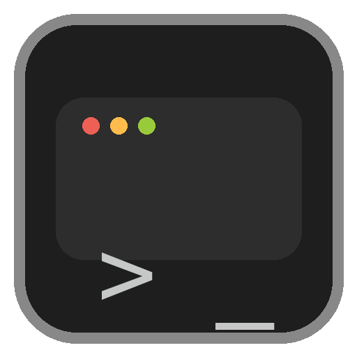

<div align="center">
  
  <h1>🍎 mac-setup</h1>
  <p>
    
    
    
    
  </p>
</div>

My macOS setup scripts and dotfiles. Clone, run, and get a fully configured
development or music-production machine in one sitting.

These are opinionated and tailored to my workflow - there are plenty of more
"shareable" dotfile repos out there. That said, feel free to steal ideas.

## 🖥 Profiles

**WARNING:** This script does not backup any existing dotfiles or config.

Before running any commands, you must edit files according to your needs.

There are two entry-point scripts, each targeting a different machine role:

| Script | Purpose |
|---|---|
| `./osx_dev_install` | General development environment - CLI tools, languages, containers, AI tooling |
| `./osx_desktop_install` | Music production + desktop dev - everything above minus some dev-only extras, plus DAWs, soft synths and audio tools |

Both scripts walk you through every step interactively (yes/no per module), so
you can skip anything or safely re-run after a failure.

## 🔒 Requirements

- **Apple Silicon (ARM) only** — Intel is not supported
- **macOS Sequoia 15+**
- **zsh** as default shell
- Signed in to the **Apple App Store** (for MAS installs)

## 🚀 Quick Start

**This script does not backup any existing dotfiles or config. Please read the scripts before running.**

```shell
cd ~
git clone https://github.com/harricoder/mac-setup.git
cd mac-setup

# Development machine
./osx_dev_install

# OR music production / desktop machine
./osx_desktop_install
```

Each module asks for confirmation before executing, so you can bail at any point.

## 📦 What Gets Installed

### CLI Tools

`ack` `aircrack-ng` `ansible` `ansible-lint` `asciinema` `awscli` `cloc`
`composer` `cookiecutter` `fzf` `git` `gnupg` `golang` `graphviz` `grep`
`htop` `httpie` `java` `jq`
`jpegoptim` `mas` `ncurses` `nmap` `openssl` `optipng` `php` `pngquant`
`ruby` `rust` `siege` `ssh-copy-id` `telnet` `tldr` `tree` `vim` `watch`
`wget` `zsh-completions` `zsh-syntax-highlighting`

HashiCorp: `packer` `terraform` `vault`

Atlassian: `acli`

Containers: `docker` `docker-completion` `kubernetes-cli` `minikube`

> Desktop profile installs a subset of the above (drops security/image-optimisation tools).

### Applications

`1Password` `Affinity` `balenaEtcher` `Blender` `Canva` `draw.io`
`Dropzone` `Elgato Stream Deck` `ExpressVPN` `Firefox` `GitHub Desktop`
`Google Chrome` `ImageOptim` `iTerm2` `JetBrains Toolbox` `Logi Options+`
`Mockuuups Studio` `Notion` `Parallels` `Pixel Picker` `Postman`
`Sourcetree` `Spotify` `Suspicious Package` `Transmit` `Unity Hub`
`VirtualBox` `Visual Studio Code` `VLC` `Wireshark`

> Desktop profile swaps out a few dev-only apps (e.g. no ExpressVPN, Firefox, ImageOptim, Unity Hub, VirtualBox, Wireshark) and adds Calibre.

### AI Tools (dev profile only)

`Claude` (CLI + desktop app) · `Codex` (CLI + ChatGPT desktop app) · `Cursor`

Installed via a dedicated `ai.zsh` module.

### Music Production (desktop profile only)

`Guitar Pro` `iLok License Manager` `IK Product Manager`
`Native Access` `PreSonus Universal Control` `Spitfire Audio` `Synthesia`

### Mac App Store

`The Unarchiver` `Xcode` `Blackmagic Disk Speed Test` `Todoist`
`Microsoft OneNote` `Microsoft Excel` `Microsoft Word`
`Microsoft Outlook` `Microsoft PowerPoint` `Boop` `TextSniper`

> Dev profile also installs `Microsoft Remote Desktop`.

### Languages & Runtimes

| Language | Manager | Details |
|---|---|---|
| **Node** | nvm | Latest Node + Yarn |
| **Python** | uv | Latest Python 3 |
| **Ansible** | Homebrew | `ansible` + `ansible-lint` |
| **Go** | Homebrew | Configured with `GOPATH` + godoc |
| **Rust** | Homebrew | Installed via brew formula |
| **Ruby** | Homebrew | Installed via brew formula |
| **PHP** | Homebrew | Installed via brew formula |
| **Java** | Homebrew | Installed via brew cask |

### Shell & Dotfiles

- Copies dotfiles to `~/` (does **not** symlink)
- Installs and configures [Prezto](https://github.com/sorin-ionescu/prezto) for zsh
- Copies iTerm2 profile, terminal background and profile picture

### macOS Defaults

Opinionated `defaults write` commands covering:

- Screenshot format (PNG) and save location (Desktop)
- Disable natural scrolling, smart quotes, smart dashes
- Dock: auto-hide, icon size, highlight hover
- Prevent Photos auto-open on device plug-in
- No .DS_Store on network volumes
- Finder: show hidden files, disable empty-trash warning
- Save to disk by default (not iCloud)

### Git Config

- Global `.gitignore`
- Editor set to `vim`, pull strategy `ff-only`, default branch `main`
- GPG signing (interactive setup)
- Aliases: `slog`, `brag`, `reset-branch`, `co`, `cob`, `ci`, `st`, `br`

## ⚙️ How It Works

Each entry-point script sources small, focused modules from `scripts/`. You are
prompted with a yes/no before every module runs, making the whole process
interactive and re-runnable. The rough order is:

1. Homebrew + cask packages
2. Mac App Store apps (via `mas`)
3. AI tools (dev only)
4. Languages & runtimes (Node, Python, Go)
5. Minikube config (dev only)
6. Git configuration
7. Dotfiles + shell (zsh / Prezto)
8. macOS defaults
9. Manual post-install reminders

## 🔧 Customisation

| Want to… | Edit |
|---|---|
| Add/remove Homebrew packages | `scripts/dev/brew.zsh` or `scripts/desktop/brew.zsh` |
| Add/remove App Store apps | `scripts/dev/mas.zsh` or `scripts/desktop/mas.zsh` |
| Change AI tools | `scripts/dev/ai.zsh` |
| Tweak macOS defaults | `scripts/dev/mac.zsh` or `scripts/desktop/mac.zsh` |
| Edit dotfiles | `dotfiles/` directory |
| Change shell/Prezto config | `scripts/shared/zsh.zsh` |
| Modify git setup | `scripts/shared/git.zsh` |
| Adjust post-install reminders | `scripts/dev/manual.zsh` or `scripts/desktop/manual.zsh` |

## 📋 Post-Install

The scripts will walk you through these at the end, but for reference:

**Mac settings** — adjust monitor arrangement, enable Firewall, configure Finder sidebar, update profile image / wallpaper, tidy the Dock.

**Sign in to apps** — 1Password, Google Chrome, Office 365, Todoist, Spotify, JetBrains Toolbox, Parallels, Transmit, Dropzone.

**Developer bits** — import iTerm2 profile, create/copy SSH + GPG keys, fix zsh completions (`compaudit | xargs chmod g-w`).

**Music tools** (desktop only) — sign in to iLok, Synthesia, Studio One; download EastWest Installation Center; enter Guitar Pro licence.

**Backups** — copy files from Time Machine, plug in iPhone, set up Time Machine on external drive.

## 🙏 Credits

[Homebrew](https://brew.sh/) and [mas](https://github.com/mas-cli/mas) make
all of this possible. Inspired by countless dotfile repos across GitHub.

## 📄 License

[MIT](LICENSE)
